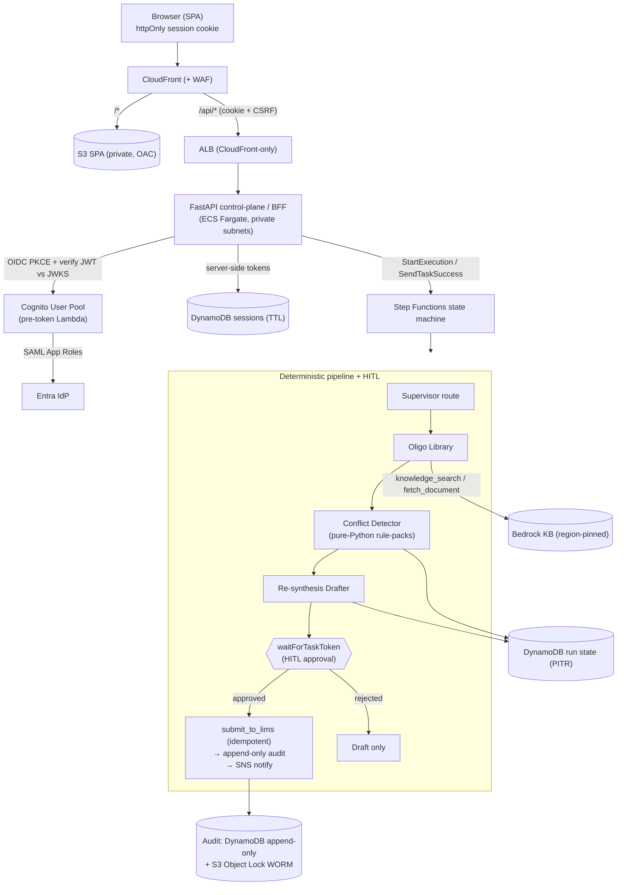
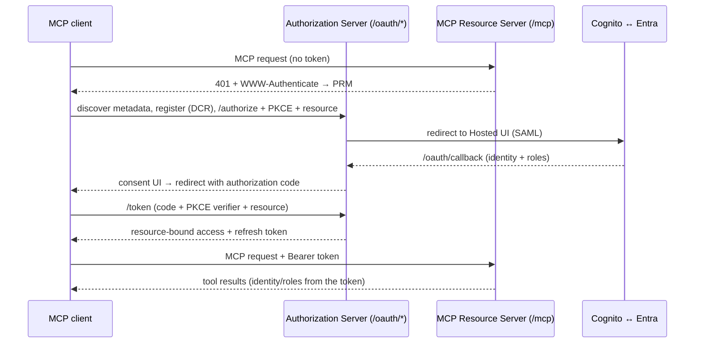

```
      A=T   G≡C   T=A   C≡G   A=T   G≡C   T=A   C≡G
       \   / \   / \   / \   / \   / \   / \   / \
        G≡C   T=A   C≡G   A=T   G≡C   T=A   C≡G

   ██████╗ ██╗     ██╗ ██████╗  ██████╗ ███████╗
  ██╔═══██╗██║     ██║██╔════╝ ██╔═══██╗██╔════╝
  ██║   ██║██║     ██║██║  ███╗██║   ██║███████╗
  ██║   ██║██║     ██║██║   ██║██║   ██║╚════██║
  ╚██████╔╝███████╗██║╚██████╔╝╚██████╔╝███████║
   ╚═════╝ ╚══════╝╚═╝ ╚═════╝  ╚═════╝ ╚══════╝
        p r e c i s i o n   ·   a g e n t s

        G≡C   T=A   C≡G   A=T   G≡C   T=A   C≡G
       /   \ /   \ /   \ /   \ /   \ /   \ /   \
      C≡G   A=T   G≡C   T=A   C≡G   A=T   G≡C   T=A
```

<div align="center">

**A Well-Architected, open-source multi-agent platform that turns oligonucleotide-synthesis QC into a deterministic, fully-audited, human-approved workflow.**

 &nbsp;  &nbsp;  &nbsp;  &nbsp;  &nbsp; 

</div>

**Your LLM shouldn't decide whether an oligo passes QC — the SOP should.** Precision Oligos puts a supervisor/router over a pool of [pydantic-ai](https://ai.pydantic.dev/) + [Amazon Bedrock](https://aws.amazon.com/bedrock/) specialists, orchestrated asynchronously by AWS Step Functions, and keeps the compliance-critical conflict-detection path as **pure deterministic Python** (pluggable SOP rule-packs). The model routes, extracts structured fields, and formats cited outputs — it never invents a conflict, and every quoted value is verified verbatim against its source document or the run is flagged for a human.

Three things set it apart:

1. **Deterministic where compliance needs it.** SOP-QC-008 is code, not inference. Rule-packs are pure functions, unit-tested, and re-runnable — the audit path never depends on a model's mood.
2. **Auditable end to end.** Every routing decision, extraction, conflict, draft, and maker-checker approval lands in an append-only DynamoDB log mirrored to an S3 Object Lock (WORM) bucket, keyed on the opaque Cognito `sub` rather than PII.
3. **Generic and deployable.** Zero customer branding anywhere; everything organisation-specific is `envid`-driven configuration. One `terraform apply` per environment, one GitHub Actions push to deploy.

> Motivation: the real constraint in oligo work is data quality, curation, metadata, and capturing negative outcomes — not model capability. See Genedata's [data-centric argument](https://www.genedata.com/resources/learn/details/blog/why-ai-alone-will-not-solve-oligonucleotide-discovery).

**Jump to** → [What's inside](#whats-inside) · [Architecture](#architecture) · [How it works](#how-it-works) · [Data model](#data-model) · [Quick start](#quick-start) · [Configuration](#configuration) · [MCP server](#remote-mcp-server) · [Testing](#testing-and-evaluation) · [Deployment](#deployment) · [Tracing](#tracing-and-the-observability-data-lake) · [Extending](#extending-the-platform) · [Well-Architected notes](#well-architected-notes)

## What's inside

Loud where it's earned, blunt about the rest. Everything below is code-complete and unit-tested; what it has **not** done yet is run against a live AWS account or real Bedrock knowledge base — there are no benchmark numbers here, only an architecture you can read and run.

| Layer | What it does | Status |
|---|---|---|
| 🧬 **Rule-packs (SOP-QC-008)** | 6 deterministic conflict rules + 14-day escalation; pluggable registry | ✅ Implemented · unit-tested |
| 🤖 **Specialist pool** | supervisor router + 7 pydantic-ai/Bedrock + deterministic specialists | ✅ Implemented |
| ⛓️ **Orchestration** | Step Functions pipeline with `waitForTaskToken` HITL approval | ✅ Implemented |
| 🔐 **Auth (BFF)** | Cognito ↔ Entra SAML, server-held tokens, CSRF, maker-checker | ✅ Implemented |
| 🖥️ **Review SPA** | React + Vite UI: submit, poll, render cited report, approve/reject | ✅ Implemented |
| 🔌 **Remote MCP server** | Streamable-HTTP MCP with OAuth 2.1 (DCR, PKCE, resource-bound tokens) brokered to Cognito/Entra + consent UI | ✅ Implemented · tested |
| 📜 **Immutable audit** | append-only DynamoDB → S3 Object Lock WORM mirror | ✅ Implemented |
| 🔭 **Tracing / data lake** | pydantic-ai OTel via Logfire → Kinesis Firehose → S3 (Athena) | ✅ Implemented |
| 🏗️ **Terraform IaC** | network / backend / edge / auth modules + CI bootstrap | ✅ Implemented · `validate` clean |
| 🚀 **CI/CD** | GitHub Actions, OIDC, branch → environment, no long-lived keys | ✅ Implemented |
| ☁️ **Live Bedrock retrieval / drafting** | needs a configured KB + model access to exercise | 🧪 Requires AWS |

## Architecture



## How it works

The FastAPI app is a thin **control-plane**: it authenticates the caller, starts executions, serves run state, and relays approvals. All slow LLM work runs inside the **Step Functions** state machine, so nothing long-running sits synchronously behind CloudFront and the ALB.

- **Steps** run as Lambda tasks (reusing this package's container image): supervisor routing, Oligo Library retrieval and extraction, the deterministic Conflict Detector, the Re-synthesis Drafter, and post-approval writes. Each step updates `RunState` in DynamoDB; the SPA polls `GET /api/runs/{id}`.
- **Human-in-the-loop (HITL)** uses a `waitForTaskToken` task. After a draft order is produced, the machine pauses holding a task token. `POST /api/runs/{id}/approve` validates the caller's role against the severity-derived approval level and calls `SendTaskSuccess`; `reject` calls `SendTaskFailure`. Timeouts and heartbeats bound the wait.
- **Determinism where compliance needs it:** conflict detection is decided purely by registered rule-packs (see [`rules/`](src/oligos_agents/rules)). Every quoted value in a report is verified verbatim against the source document text; if a citation cannot be verified, the run is flagged for human review rather than trusted.
- The same handlers run **in-process** via the CLI for local development without deploying Step Functions.

### Specialist pool

| Agent | Type | Output |
|---|---|---|
| Supervisor | 🤖 LLM (router) | routed `Intent` |
| Oligo Library | 🤖 LLM (extraction) | `list[OligoRecord]` (full documents, not snippets) |
| Conflict Detector | 🧬 **Deterministic** | cited `ConflictReport` |
| Re-synthesis Drafter | 🤖 LLM (drafting) | `ResynthesisOrder` (Markdown, `status="draft"`) |
| Batch/Trend Health | 🧬 **Deterministic** | `HealthReport` |
| Data-Quality / Metadata Gap | 🧬 **Deterministic** | `DataQualityReport` |
| Root-Cause Investigator | 🤖 LLM | `RootCauseAssessment` |
| Resequencing Recommender | 🧬 **Deterministic** | `ResequencingRecommendation` |

Models are right-sized per agent: a cheap, fast model for routing and extraction, and a stronger model (Claude Sonnet 5) only for drafting. All extraction runs at temperature 0.

## Data model

Persistence uses **four purpose-built DynamoDB tables rather than a single-table design**. This is deliberate: the tables have divergent security postures and lifecycles that are enforced at the *table* level, and collapsing them would weaken the compliance guarantees.

| Table | Key | Lifecycle | Isolated because |
|---|---|---|---|
| `runs` | `run_id` (+ GSIs `by_status` / `by_batch` / `by_submitter`) | mutable, PITR | operational pipeline state |
| `audit` | `run_id` + `sk` | **append-only, long-retained** | table-scoped IAM `Deny` on update/delete + Streams → S3 Object Lock (WORM) |
| `sessions` | `session_id` | **TTL auto-expire** | short-lived BFF secrets |
| `mcp_oauth` | `pk` = `"<kind>#<id>"` | **TTL auto-expire** | overloaded single-table for OAuth clients/codes/tokens |

Why not one table:

- **Append-only integrity is table-granular.** The audit trail's immutability comes from an IAM `Deny` on `UpdateItem`/`DeleteItem`/`BatchWriteItem` for that table (plus a conditional put). IAM cannot scope a deny to "audit items" within a shared table, so a merge would downgrade WORM integrity to weaker per-item conditions.
- **Streams and TTL are table-level and conflict.** Only the audit table streams to the WORM mirror, and `sessions` / `mcp_oauth` rely on TTL expiry that `audit` must never be subject to. One table cannot both auto-expire some entities and guarantee others are never reaped.
- **Smaller blast radius / clearer data classification** for secrets vs. operational state vs. compliance records.

Where entities *do* share a lifecycle and IAM scope, the single-table pattern is used: `audit` is a composite-key item collection per run, and `mcp_oauth` overloads one table across all OAuth entity kinds.

## Quick start

Requirements: Python 3.12+, [uv](https://docs.astral.sh/uv/) (recommended), Node.js 24 for the SPA (see [`.nvmrc`](.nvmrc); run `nvm use`).

```bash
# 1. Configure
cp .env.example .env
# For a fully offline run, set LOCAL_AUTH_BYPASS=true and leave AWS ids blank.
# With no DynamoDB tables configured, an in-memory run store is used automatically.

# 2. Install dependencies
uv sync --extra dev

# 3. Run the pipeline in-process (no AWS orchestration required)
uv run oligos-agents run "Check QC conflicts for batch B-2024-0419-003"

# 4. Inspect and approve a run (maker-checker: approver must differ from submitter)
uv run oligos-agents show <run-id>
uv run oligos-agents approve <run-id> --sub reviewer-1 --role QCManager

# 5. Serve the control-plane API
uv run oligos-agents serve --reload
```

Run the SPA against the local API (the Vite dev server proxies `/api`):

```bash
cd frontend
npm install
npm run dev
```

> Retrieval and drafting require a configured Bedrock knowledge base and model access. Without them, the deterministic rule-packs, specialists, approval flow, and API auth are all still exercisable locally and under test.

## Configuration

All settings are environment variables (see [`.env.example`](.env.example)); there are no hard-coded organisation names or account details. Key groups:

| Group | Variables |
|---|---|
| Identity | `ENVID`, `AWS_REGION`, `LOGGER_LEVEL` |
| Models | `ROUTER_MODEL`, `EXTRACTION_MODEL`, `DRAFTING_MODEL`, `BEDROCK_GUARDRAIL_ID`, `BEDROCK_GUARDRAIL_VERSION` |
| Knowledge base | `KNOWLEDGE_BASE_ID`, `KNOWLEDGE_BASE_REGION`, `KB_ASSUME_ROLE_ARN`, `KB_ASSUME_ROLE_EXTERNAL_ID` |
| Storage | `RUNS_TABLE`, `AUDIT_TABLE`, `SESSIONS_TABLE`, `AUDIT_WORM_BUCKET` |
| Orchestration | `STATE_MACHINE_ARN` |
| Notifications | `NOTIFICATIONS_TOPIC_ARN` |
| LIMS | `LIMS_BASE_URL`, `LIMS_API_KEY_SECRET_ARN`, `LIMS_TIMEOUT_SECONDS` |
| Authentication | `COGNITO_USER_POOL_ID`, `COGNITO_CLIENT_ID`, `COGNITO_CLIENT_SECRET_ARN`, `COGNITO_DOMAIN`, `COGNITO_REGION`, `COGNITO_SAML_PROVIDER_NAME`, `PUBLIC_BASE_URL`, `SESSION_*` |
| Tracing / data lake | `SERVICE_VERSION`, `OTEL_FIREHOSE_STREAM`, `OTEL_CAPTURE_CONTENT`, `LOGFIRE_TOKEN`, `LOGFIRE_TOKEN_SECRET_ARN` |
| MCP server | `MCP_ENABLED`, `MCP_OAUTH_TABLE`, `MCP_SCOPES`, `MCP_ACCESS_TOKEN_TTL_SECONDS`, `MCP_REFRESH_TOKEN_TTL_SECONDS`, `MCP_CODE_TTL_SECONDS` |
| Local convenience | `LOCAL_AUTH_BYPASS`, `LOCAL_AUTH_ROLES` |

The Bedrock model ids intentionally use **region-pinned inference profiles** (for example `eu.anthropic...`) rather than `global.*`, for data residency.

## Remote MCP server

The platform exposes an **OAuth-protected remote MCP server** so agentic clients (Claude, Cursor, etc.) can do everything the review SPA does — submit a QC request, poll run state, read the cited report/draft, and approve or reject — through the same maker-checker and audit path. Tools delegate to a shared [`runs_service`](src/oligos_agents/runs_service.py), so an MCP approval is subject to the identical segregation-of-duties and Step Functions task-token handling as a click in the UI.

**Tools:** `whoami`, `submit_qc_request`, `get_run`, `list_my_runs`, `approve_run`, `reject_run`.

Authentication follows the **MCP authorization spec (2025-06-18)**, cleanly separating the two OAuth roles:

- The **Resource Server** is the MCP endpoint at `/mcp` (Streamable HTTP, built on the official `mcp` SDK). It only ever *consumes* tokens: it publishes RFC 9728 Protected Resource Metadata, returns `401` with a `WWW-Authenticate` pointing at it, validates the bearer token against the shared store, and enforces the **RFC 8707 audience binding** (`resource == https://…/mcp`).
- The **Authorization Server** ([`auth/oauth_as.py`](src/oligos_agents/auth/oauth_as.py)) is a compact OAuth 2.1 server hosted by the same app. It implements RFC 8414 metadata, **RFC 7591 Dynamic Client Registration**, and Authorization Code + **PKCE (S256)**. Rather than being an identity provider itself, it **brokers** the actual login to Cognito (which federates to Entra via SAML) and renders the **consent screen** the user approves before control returns to the MCP client.



Tokens are opaque and validated by lookup in a dedicated, TTL'd DynamoDB table (`MCP_OAUTH_TABLE`) — so they are revocable and no signing key is shared. With `LOCAL_AUTH_BYPASS=true` the `/authorize` step skips Cognito and goes straight to consent, so the full flow can be driven end-to-end locally (see [`tests/test_mcp_oauth.py`](tests/test_mcp_oauth.py)). At the edge, CloudFront routes `/mcp*`, `/oauth/*`, and `/.well-known/*` to the API and forwards the `Authorization` header.

### Discovery and endpoint layout

Discovery is anchored on **two well-known documents served at the origin root**, which is what most MCP clients (and the RFC 9728 → RFC 8414 chain) expect:

| Path | Serves | Points at |
|---|---|---|
| `/.well-known/oauth-protected-resource/mcp` | Resource metadata (RFC 9728) | `authorization_servers: [PUBLIC_BASE_URL]` |
| `/.well-known/oauth-authorization-server` | Authorization-server metadata (RFC 8414) | `authorization_endpoint`, `token_endpoint`, `registration_endpoint` under `PUBLIC_BASE_URL/oauth/*` |

The flow is self-bootstrapping from a single URL: a client is given only the resource URL (`PUBLIC_BASE_URL/mcp`), hits it unauthenticated, follows the `resource_metadata` link in the `401`'s `WWW-Authenticate` header to the resource document, reads `authorization_servers`, and fetches the AS metadata from **the origin root** — no separate auth domain to configure. Because `authorization_servers` and every advertised endpoint are derived from **`PUBLIC_BASE_URL`**, the resource server, authorization server, and consent UI all live on the same origin behind CloudFront, so clients that assume root-hosted AS metadata resolve it correctly. Set `PUBLIC_BASE_URL` to the public CloudFront (or custom-domain) URL — the metadata is generated from it at runtime, not hard-coded.

## Testing and evaluation

```bash
# Unit tests (rule-packs, authorisation, BFF/CSRF helpers, approval flow, state machine, specialists)
uv run --extra dev pytest -q

# Include the span-serialisation / data-lake exporter tests (needs the tracing extra)
uv run --extra dev --extra tracing pytest -q

# Lint
uv run --extra dev ruff check src tests evals

# Deterministic evaluation harness (safe to run in CI, no LLM calls)
uv run python -m evals.run
```

The evaluation harness scores extraction correctness, verbatim-citation validity, and — optionally, when Bedrock is configured — router intent accuracy. Deterministic evals run in CI to catch rule-pack and citation regressions.

## Project layout

```
src/oligos_agents/
  config.py  deps.py  models.py  prompts.py  authz.py  store.py
  app.py  __main__.py  statemachine.py  observability.py  tracing.py  logging_utils.py
  auth/       bff.py  session.py  jwt_verify.py  csrf.py
  rules/      base.py  sop_qc_008.py
  tools/      knowledge.py  lims.py  audit.py  notify.py
  agents/     supervisor.py  oligo_library.py  conflict_detector.py  resynthesis_drafter.py
              batch_health.py  data_quality.py  root_cause.py  resequencing.py
  workflows/  conflict_resynthesis.py
  steps/      pipeline.py  handlers.py
frontend/     Vite + React SPA → dist/ (synced to S3) + runtime config.json
terraform/    modules/{network,backend,edge,auth}  bootstrap/  backend-config/
tests/  evals/  Dockerfile
.github/workflows/  checks.yml  deploy.yml
```

## Authentication: Cognito + Entra SAML

Enterprise SSO only — there are no local accounts. The FastAPI control-plane implements the **backend-for-frontend (BFF)** pattern, so JWTs never touch JavaScript.

1. **Federation.** A Cognito User Pool trusts an external **SAML identity provider** built from Entra metadata (a URL or an XML file, supplied as a Terraform variable). Login is SP-initiated; single logout is wired through the Cognito logout endpoint.
2. **Roles from Entra App Roles.** Entra emits stable App Role strings (`QCApprover`, `QCLead`, `QCManager`, `Director`). A **pre-token-generation Lambda** normalises them into `cognito:groups`, so the application reads a clean, trustworthy claim set.
3. **Token handling.** `GET /api/auth/login` redirects to the Cognito Hosted UI (Authorization Code + PKCE). `GET /api/auth/callback` exchanges the code, stores tokens **server-side** in the DynamoDB `sessions` table (TTL), and sets an `httpOnly` + `Secure` + `SameSite` cookie holding only an opaque session id. `POST /api/auth/logout` clears the session and triggers logout. CSRF is enforced by a double-submit token on all state-changing calls.
4. **Authorisation.** Every `/api` route requires a valid session (only `/healthz` is open). The approval gate enforces **segregation of duties (maker-checker)**: the approver must not be the submitter, and their role must satisfy the severity-derived level. See [`authz.py`](src/oligos_agents/authz.py).

For local development, set `LOCAL_AUTH_BYPASS=true` and `LOCAL_AUTH_ROLES=QCManager` to work without Cognito.

## Deployment

Infrastructure is Terraform, split into four modules (`network`, `backend`, `edge`, `auth`) plus a one-off `bootstrap` stack for CI/CD identity and remote state. Resource naming follows the workspace AWS naming standard, driven by `envid`.

### 1. Bootstrap (once per AWS account, with elevated credentials)

Creates the S3 remote-state bucket, the GitHub OIDC provider, per-environment deploy roles (scoped by branch), and a read-only PR-plan role.

```bash
cd terraform/bootstrap
cp terraform.tfvars.example terraform.tfvars   # set github_org, github_repo, state_bucket_name
terraform init && terraform apply
```

### 2. Per-environment infrastructure

State is kept separately per `envid`.

```bash
cd terraform
terraform init -backend-config=backend-config/development.s3.tfbackend
terraform apply \
  -var="envid=acme-oligos-dev" -var="environment=dev" \
  -var="container_image=<ecr-image-uri>" \
  -var="cognito_domain_prefix=acme-oligos-dev" \
  -var="entra_saml_metadata_url=<entra-metadata-url>"
```

### 3. Continuous delivery (GitHub Actions + AWS OIDC)

Branch → environment, with no long-lived AWS keys:

| Branch | Environment |
|---|---|
| `development` | development |
| `release/vX.X.X` (semver) | staging |
| `production` | production |

- [`checks.yml`](.github/workflows/checks.yml) runs on pull requests only: `ruff`, `pytest`, the deterministic eval harness, frontend build, Docker build + Trivy scan, and `terraform fmt/validate` (plus an optional read-only plan). **PRs never deploy.**
- [`deploy.yml`](.github/workflows/deploy.yml) runs on push to the deploy branches: resolves the target environment, assumes AWS via OIDC, builds and pushes the image to ECR (tagged with version + SHA), runs `terraform apply` for that `envid`, builds and syncs the SPA to S3 with a generated `config.json`, invalidates CloudFront, and runs a `/healthz` smoke test. A per-environment concurrency group serialises deploys.

Configure GitHub Environments (`development`, `staging`, `production`) with the env-scoped variables and the `AWS_DEPLOY_ROLE_ARN` secret produced by the bootstrap stack, and add required reviewers on `production`.

## Tracing and the observability data lake

pydantic-ai emits rich OpenTelemetry spans for every agent run, tool call, and model request (including `gen_ai.*` token-usage attributes). These are captured with [Logfire](https://logfire.pydantic.dev/) (Pydantic's OTel-based SDK) and fanned out to two optional sinks:

- **Logfire platform** — live observability, enabled when a `LOGFIRE_TOKEN` is configured (directly, or resolved at runtime from Secrets Manager via `LOGFIRE_TOKEN_SECRET_ARN`).
- **S3 data lake** — durable, queryable history. A custom OTel `SpanExporter` serialises spans to newline-delimited JSON and pushes them to a **Kinesis Data Firehose** delivery stream, which buffers, GZIP-compresses, date-partitions (`environment/dt/hour`), and lands them in S3. A **Glue table with partition projection** makes the lake immediately queryable from **Athena** — e.g. token spend per agent/model over time. Firehose is fire-and-forget, so it never blocks a short-lived Lambda step or a request behind the API.

Everything is optional and best-effort: with no sinks configured (and/or the `tracing` extra not installed), the platform runs exactly as before. Content capture (prompts/responses, which may contain sensitive retrieved documents) is **off by default** and gated behind `OTEL_CAPTURE_CONTENT`. Enable the sinks per environment with the `logfire_token`, `otel_capture_content`, and `traces_retention_days` Terraform variables; the Firehose stream name is injected automatically. Install the runtime dependency with the `tracing` extra (`uv sync --extra tracing`).

Example Athena query once data has landed:

```sql
SELECT attributes['gen_ai.request.model'] AS model,
       sum(cast(attributes['gen_ai.usage.input_tokens'] AS bigint))  AS input_tokens,
       sum(cast(attributes['gen_ai.usage.output_tokens'] AS bigint)) AS output_tokens
FROM oligo_traces_<envid>.spans
WHERE environment = 'dev' AND dt >= date_format(current_date - interval '7' day, '%Y-%m-%d')
GROUP BY 1 ORDER BY 2 DESC;
```

## Extending the platform

### Adding a rule-pack

Conflict detection is fully pluggable. Define rules as pure functions of an `OligoRecord`, bundle them into a `RulePack`, and register it — no pipeline changes required.

```python
from oligos_agents.models import Conflict, ConflictCode, OligoRecord, Severity
from oligos_agents.rules.base import RulePack, register_pack


def rule_example(record: OligoRecord) -> Conflict | None:
    if record.fastq and record.fastq.read_depth < 100:
        return Conflict(
            code=ConflictCode.SEQUENCING_INSUFFICIENT,
            severity=Severity.LOW,
            oligo_id=record.oligo_id,
            batch_id=record.batch_id,
            recommended_action="Recommend resequencing",
        )
    return None


register_pack(RulePack(code="SITE-CUSTOM-001", version="1.0.0", rules=(rule_example,)))
```

All registered packs run against every record; keep rules deterministic and side-effect free.

### Adding an agent

Add a module under `agents/` (a `pydantic-ai` `Agent[AgentDeps, OutputModel]` for LLM work, or a plain function for deterministic work), extend the `Intent` enum and supervisor prompt, and wire a step in [`steps/pipeline.py`](src/oligos_agents/steps/pipeline.py) and the state machine in [`statemachine.py`](src/oligos_agents/statemachine.py).

## Well-Architected notes

- **Operational excellence:** structured logging via AWS Lambda Powertools, pydantic-ai OpenTelemetry tracing captured through Logfire and sunk into an Athena-queryable S3 data lake, CloudWatch dashboards and alarms, and per-agent LLM token/latency telemetry for cost attribution.
- **Security:** private subnets with VPC endpoints (no public egress for AWS calls), CloudFront + WAF as the single entry point, ALB reachable only from CloudFront, OAC-secured private S3, Cognito/Entra SSO with the BFF pattern, KMS customer-managed keys, and least-privilege IAM (the audit table role is `PutItem`-only with an explicit deny on updates/deletes).
- **Reliability:** asynchronous Step Functions orchestration with retries, catches, and per-step DLQs; multi-AZ Fargate with autoscaling; idempotent LIMS writes keyed by `run_id`; DynamoDB point-in-time recovery and AWS Backup.
- **Performance efficiency:** model right-sizing per agent, deterministic rule-packs instead of inference for compliance decisions, and same-origin API routing to avoid CORS overhead.
- **Cost optimisation:** Spot capacity for non-production, Lambda-based agent steps that scale to demand, VPC endpoints to remove NAT cost, and lifecycle policies on logs and audit storage.
- **Sustainability:** no idle LLM compute, prompt-size discipline, and storage lifecycle tiering to Glacier for long-horizon audit retention.
- **Immutable audit trail:** an append-only DynamoDB table mirrored via DynamoDB Streams into an S3 Object Lock (COMPLIANCE mode) WORM bucket, storing the opaque Cognito `sub` and role rather than PII to remain compatible with the right to erasure.

## Licence

Apache-2.0. See [`pyproject.toml`](pyproject.toml).
